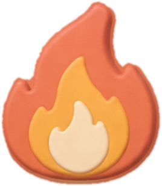
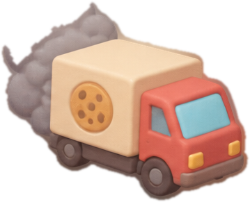

# Reglas del juego de reposición (versión 5.1.2)

Esta es la referencia del juego. Los números exactos están en `game.js` (bloque `CONFIG`, `PRODUCTOS`, `CALIDADES`, `INFLUENCERS`). Si este documento y el código no coinciden, avísame para corregir uno de los dos.

## 1. Equipos y roles

- 2 equipos de 3 jugadores: **G'sertte** y **Gallecolors**. Al iniciar el anfitrión se abre una sala de **2 minutos** donde cada persona elige equipo y puesto (el primero en confirmar un puesto lo bloquea; puede desbloquearlo para cambiar). Quien no elige, y los bots, reciben al azar los puestos que quedan.
- Cada persona elige un avatar (1 de 16, único dentro de la sala). Solo se muestra quién ocupa cada puesto de **tu** equipo, no del rival; en la pantalla final se muestran ambos equipos con avatares.
- Un lugar puede ocuparlo una persona o un **bot** (sección 16): no hacen falta 6 personas.
- Cada equipo tiene la misma cadena: **Fábrica → Distribuidor → Tienda final → clientes**.
- Cada rol es responsable de un área:
  - **Fábrica:** decide la **calidad** de cada sabor y **cuánto producir**.
  - **Distribuidor:** decide **cuánto pedir a la fábrica** y **puja por los influencers**.
  - **Tienda final:** decide el **precio** de cada sabor y **cuánto pedir al distribuidor**.

## 2. Tiempo

- Cada semana dura el tiempo que elige el anfitrión (por defecto 60 segundos, de 20 a 180).
- La partida dura **30 semanas** por defecto (de 5 a 60).
- Todas las decisiones son **simultáneas**: nadie ve lo que deciden los demás hasta que se cierra la semana.
- La semana se cierra cuando los 6 jugadores deciden, o cuando se acaba el tiempo. Los bots deciden solos apenas empieza la semana, así que con una persona y 5 bots la semana se cierra cuando esa persona decide.
- Puedes cambiar tu decisión hasta que se cierre la semana. Nadie ve las decisiones de los demás antes del cierre.
- Cualquiera puede salir de la sala durante la espera. Si el anfitrión sale durante la espera, la sala se borra.
- Si no envías tu decisión, **se envía sola** lo que tengas en pantalla unos 2 segundos antes de acabar el tiempo (si tu celular sigue abierto). Si el celular está cerrado, esa semana su equipo no cambia precio ni calidad, **no envía pedidos ni produce, y no puja**. Lo que ya tenía en stock se sigue vendiendo.

## 3. Productos

| Sabor | Demanda media del mercado por semana |
|---|---|
| Chocolate | 90 |
| Vainilla | 80 |
| Menta | 70 |
| Fresa | 60 |
| Mora | 50 |

- La demanda media de cada sabor cambia cada semana: se multiplica por un número al azar entre 0.70 y 1.30, todos igual de probables. **Es la misma para los dos equipos.**
- Costo de producir una galleta con calidad estándar: **$2.00**.
- Precio al cliente de partida: **$4.50** para todos los sabores.

## 4. Tiempos de espera

- Cada envío tarda **2 semanas** en llegar: lo que la fábrica produce, lo que el distribuidor pide a fábrica y lo que la tienda pide al distribuidor.
- Al empezar, cada equipo tiene stock y envíos en camino para que la primera semana no arranque en cero.

## 5. Stock inicial

- Fábrica: 1.5 semanas de demanda media. Distribuidor: 1 semana. Tienda: 0.5 semanas.

## 6. Fábrica

- **Calidad** (por sabor; se mantiene hasta que la cambien):

| Calidad | Costo por galleta | Factor de demanda |
|---|---|---|
| Económico | $1.60 (×0.8) | ×0.85 |
| Estándar | $2.00 | ×1.00 |
| Premium | $2.50 (×1.25) | ×1.25 |

- La calidad cambia la demanda desde esa semana. El costo cambia solo para lo que se produce **después** del cambio: cada lote conserva el costo con el que se produjo.
- **Producción:** lo que se produce llega a stock en 2 semanas. Capacidad máxima por sabor por semana: Chocolate 250, Vainilla 220, Menta 200, Fresa 180, Mora 160.

## 7. Distribuidor

- **Pedido a fábrica** (máximo 500 por sabor por semana): la fábrica despacha lo que tenga en stock. Lo que no alcance **se pierde** (no hay pedidos pendientes).

## 8. Tienda final

- **Precio por sabor:** entre $2.50 y $8.00. Se mantiene hasta que lo cambien.
- **Pedido al distribuidor** (máximo 500 por sabor por semana): llega en 2 semanas. Si el distribuidor no tiene stock, se entrega lo que haya.
- **Ventas:** cada semana se vende desde el stock de la tienda, a la demanda que le toca (sección 9).

## 9. Demanda compartida

Cada semana, para cada sabor:

1. **Mercado del sabor:** demanda media × un número al azar entre 0.70 y 1.30. Es la misma para los dos equipos.
2. **Atractivo de cada equipo** = (precio de referencia $4.50 ÷ su precio)^1.8 × factor de calidad × factor de influencers.
3. **Tamaño del mercado** = demanda del mercado × ((atractivo A + atractivo B) ÷ 2)^0.5.
4. **Demanda de cada equipo** = tamaño del mercado × su atractivo ÷ (atractivo A + atractivo B), redondeada.

Qué significa en el juego:
- Si los dos equipos son iguales, cada uno recibe **la mitad** del mercado.
- Si un equipo sube su precio, pierde parte de su demanda y **esa demanda pasa al otro equipo**.
- Si un equipo tiene mejor calidad o influencers, gana parte del mercado.
- Si los dos bajan precios o tienen influencers, **el mercado total crece**.
- El reparto es proporcional y sin azar. El azar está en el tamaño del mercado (±30%) y en el desvío de clientes (sección 10).

## 10. Desvío de clientes

- Si una tienda se queda sin stock de un sabor, los clientes que no encontraron producto pueden comprar en la **otra tienda**, **solo si esa tienda tiene stock**.
- Cada cliente sin producto lo intenta una vez. La probabilidad es un valor al azar entre 20% y 60% para cada sabor y semana, ajustado por el atractivo de cada tienda: si la otra es más atractiva, la probabilidad sube (entre 2% y 90%).

## 11. Influencers (subasta)

- Hay 3 influencers. Cada uno sube la demanda de **todos los sabores** del equipo que lo tiene:
  - **A:** entre 5% y 12%.
  - **B:** entre 8% y 13%.
  - **C:** entre 9% y 16%.
- Cada semana, el distribuidor de cada equipo puede pujar por cualquiera de los tres, por ninguno o por varios. **La puja es solo un monto** (de $1 a $10,000); no elige sabor. Pon 0 para no pujar.
- Las pujas son **secretas**.
- **Gana el monto más alto, y paga ese monto.** El que pierde no paga nada.
- **Empate en el monto más alto:** gana el equipo con **mejor calidad promedio** (promedio del factor de calidad de sus sabores: económico 0.85, estándar 1.00, premium 1.25). Si también empatan en calidad, **gana al azar**.
- Un influencer ganado dura **2 semanas** (la semana en que se gana y la siguiente). Mientras está ocupado no se puede pujar por él, y la puja se ignora sin cobrarse.
- La subida de cada influencer se sortea al ganarlo, dentro de su rango.
- Si un equipo tiene dos influencers, sus subidas **se multiplican**.
- Al terminar la semana, cada equipo ve: si ganó, perdió, estaba ocupado o no pujó. **No ve cuánto ofreció el otro equipo.** Todos ven qué equipo tiene cada influencer, su subida y cuántas semanas le quedan.

## 12. Costo de mantener inventario

- Cada semana se cobra el **3% del valor del stock** guardado en cada etapa.
- Valor de una galleta en cada etapa:
  - Fábrica: su costo de producción ($2.00 con calidad estándar).
  - Distribuidor: $2.60.
  - Tienda: $3.40.
- Por galleta guardada, cada semana cuesta: **$0.06 en fábrica, $0.078 en distribuidor y $0.102 en tienda**.
- Lo que está **en camino** no paga mantenimiento.

## 13. Cómo se calcula la ganancia del equipo

- **Ganancia = margen de ventas − mantenimiento − pujas pagadas.**
- **Margen de ventas** = por cada galleta vendida (incluidas las vendidas a clientes desviados), su precio menos el **costo de lo vendido**. El costo de lo vendido es el costo del lote de donde salió, calculado con promedio ponderado.
- El stock que queda sin vender **no es un gasto**, pero paga mantenimiento mientras está guardado.
- Gana el equipo con más ganancia acumulada al final de la partida.
- Los dos integrantes de un equipo ven el mismo marcador: el equipo gana o pierde junto.

## 14. Orden de cada semana

1. Se fijan la calidad y el precio que cambiaron.
2. Se subastan los influencers libres.
3. Llegan los envíos de esta semana a su etapa.
4. La fábrica produce y despacha al distribuidor según su pedido.
5. El distribuidor despacha a la tienda según su pedido.
6. Se calcula la demanda de cada equipo (sección 9) y se venden galletas.
7. Se aplica el desvío de clientes (sección 10).
8. Se cobra el mantenimiento del inventario.
9. Se actualiza el marcador.

## 15. Valores que son propuestas (se ajustan con las partidas de prueba)

Estos valores no vienen de tu lista original; los propuse para que el juego funcione. Confirma o cambia cualquiera:

- Exponente de elasticidad del precio: 1.8.
- Crecimiento del mercado total (exponente): 0.5.
- Ruido de la demanda: ±30%.
- Capacidad de producción por sabor (sección 6).
- Pedido máximo por sabor: 500 unidades. Puja máxima: $10,000.
- Desempate de la subasta por calidad promedio (sección 11).
- Reglas de los bots (sección 16): cobertura de 4 semanas de demanda, calidad estándar, precio $4.50, ofertas del 15% al 25% de la ganancia esperada de un influencer.

## 16. Bots

Un bot es un jugador que maneja el juego. Ocupa un lugar (fábrica, distribuidor o tienda) y sus decisiones cuentan igual que las de una persona: su equipo gana o pierde con ellas.

**Cómo se usan**
- El anfitrión puede llenar con bots los lugares vacíos de la sala de espera, o empezar una partida de prueba desde la pantalla de inicio (1 persona + 5 bots).
- Si una persona entra con el código a una sala que ya está llena, toma el lugar de un bot.
- Los bots deciden **apenas empieza cada semana**. Sus decisiones las envía el celular de cualquier persona que tenga la partida abierta; si todas las personas cierran la página, la partida se detiene hasta que alguien vuelva.

**Qué deciden** (todo está en `game.js`, bloque `BOT` y función `decisionBot`)
- Solo miran su propio equipo (stock, pedidos en camino y lo ocurrido las últimas 3 semanas) y los influencers libres u ocupados. No ven las decisiones de la semana en curso del rival.
- Para estimar cuánto se va a pedir o vender usan el **promedio de las últimas 3 semanas**; en la primera semana suponen que cada equipo atiende la mitad de la demanda del mercado.
- **Fábrica:** calidad estándar en todos los sabores. Produce lo necesario para tener, entre stock y producción en camino, **4 semanas** de lo que suele pedirle el distribuidor (sin pasar la capacidad del sabor).
- **Distribuidor:** pide a la fábrica para tener **4 semanas** de lo que suele pedirle la tienda. Puja por un influencer libre solo si la tienda tiene al menos 1.5 semanas de stock; ofrece entre el 15% y el 25% de la ganancia extra que estima (varía por semana). Nunca puja por un influencer ocupado.
- **Tienda:** precio de $4.50 en todos los sabores, y pide al distribuidor para tener **4 semanas** de la demanda reciente.
- No usan azar: la misma situación da siempre la misma decisión, por eso todos los celulares ven exactamente la misma partida.

**Qué esperar de ellos** (resultado de 200 partidas simuladas de 30 semanas)
- Dos equipos de bots atienden alrededor del 98% de la demanda y quedan parejos: cada uno gana cerca de la mitad de las partidas.
- Un equipo de bots le gana siempre a un equipo que no decide nada.
- Ofrecer poco por los influencers rinde más que ofrecer mucho cuando ambos equipos pujan; por eso las ofertas son del 15% al 25%.
- No son expertos: son un rival razonable para probar el juego y completar equipos, no un jugador óptimo.

## 17. Eventos aleatorios
Desde la semana 5 se evalúa si aparece un evento: 31 % la primera vez; cada evaluación fallida suma 5 puntos (máximo 100 %). Al aparecer se elige uno de los 9 con igual probabilidad entre los que aún no salieron en esa partida (un evento no se repite hasta que hayan salido los 9), la probabilidad vuelve a 31 % y se espera 5 semanas. No hay eventos simultáneos. El efecto empieza de inmediato, dura lo indicado (4 semanas; la huelga, 1) y modifica temporalmente la demanda base de cada sabor. La **huelga** no cambia la demanda: ese cierre de semana no se procesan llegadas (producción ni traslados); lo pendiente llega junto con lo de la semana siguiente. La presentación del evento dura 15 s (la semana recibe 15 s extra). Los eventos se calculan con la semilla de la sala, así que todos los celulares ven lo mismo. El catálogo completo está en `GUIA.md`.

## 18. Dificultad
Al crear la sala se elige 3, 4 o 5 sabores (de arriba hacia abajo: chocolate, vainilla, menta, fresa, mora). Todas las reglas son iguales; solo cambia la cantidad de sabores en producción, pedidos, demanda y ventas.

## 19. Habilidades especiales
Cada rol tiene una habilidad exclusiva contra el equipo rival (nunca contra el propio):
-  **Incendio** (Tienda): destruye 30 % del inventario del almacén de la tienda rival, igual en todos los sabores. Cuesta $70; enfriamiento 8 semanas.
-  **Fake News** (Distribuidor): −15 % de demanda en todos los sabores del rival durante 2 semanas. Cuesta $50; enfriamiento 6 semanas.
-  **GTA** (Fábrica): el último camión despachado por la fábrica rival pierde 35 % de su carga. Cuesta $110; enfriamiento 10 semanas.

Costos para 5 sabores (con 3 o 4 bajan en proporción). Reglas: se eligen durante la semana t y se envían junto con la decisión de esa semana; el costo sale del dinero compartido del equipo al cerrar la semana t (siempre, aunque no haya nada que dañar; solo si alcanza el dinero y no hay enfriamiento); el efecto se ejecuta al procesar la semana t+1, antes de llegadas y ventas. Los 3 integrantes del equipo afectado ven un aviso rojo al comenzar la semana de ejecución. La mercadería destruida o perdida se registra como pérdida a su costo. El enfriamiento cuenta desde la semana en que se usó. No se puede usar en la última semana.
